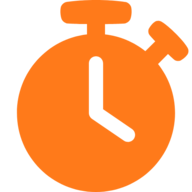
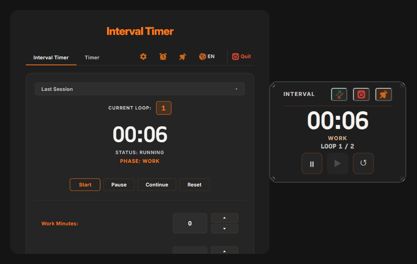
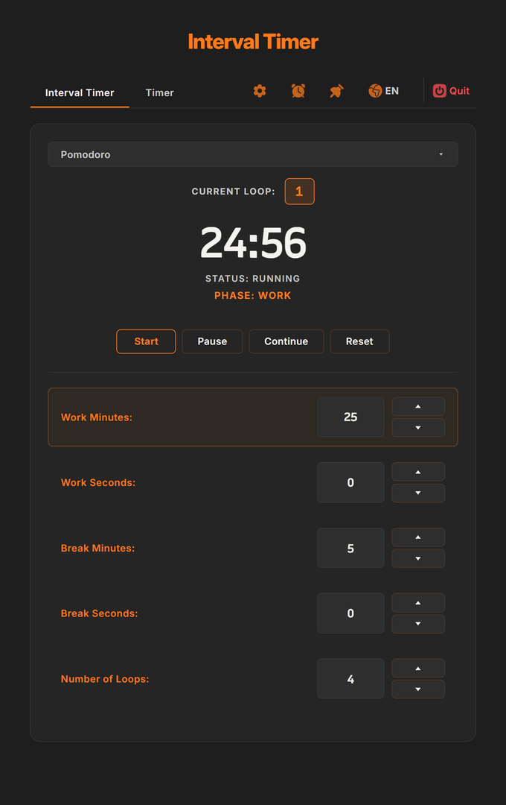
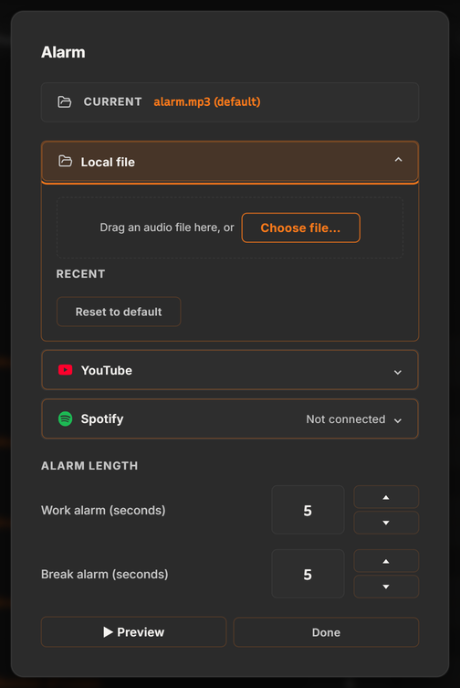
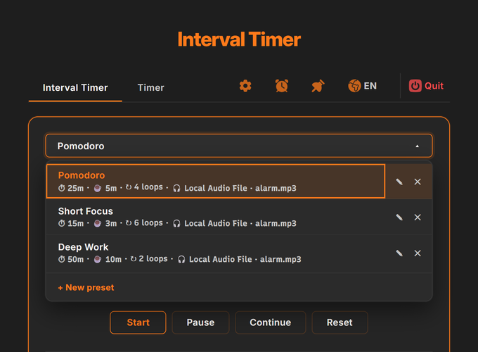
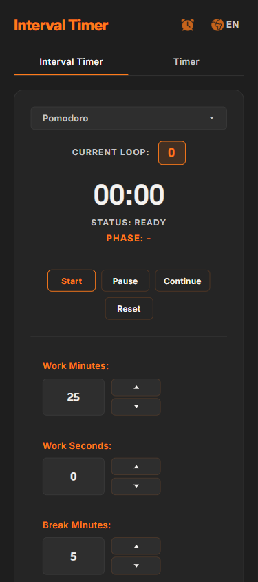
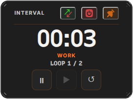
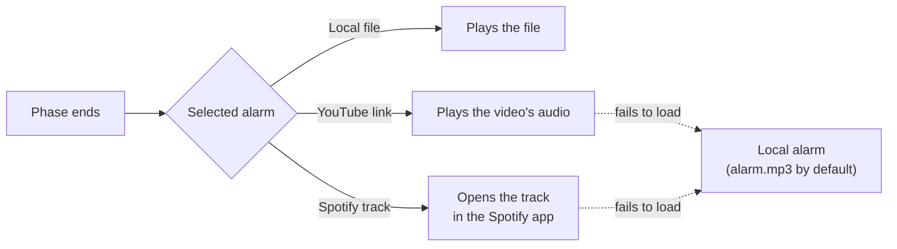

<p align="center">
  
</p>

<h1 align="center">Interval Timer</h1>

<p align="center">
  <b>A work/break timer that wakes you up with your own music.</b><br>
  Set work and break lengths and a number of loops, then pick the alarm: a local audio file, a YouTube video or a Spotify track.<br>
  A small always-on-top window keeps the countdown in view while you work.
</p>

<p align="center">
  <a href="https://github.com/ege-ozel/interval-timer/releases/latest"></a>
  <a href="https://github.com/ege-ozel/interval-timer/releases"></a>
  
  
  
  
  
</p>

<p align="center">
  <a href="https://github.com/ege-ozel/interval-timer/releases/latest" title="Opens the latest release with the Windows installer"></a>
  &nbsp;
  <a href="https://ege-ozel.github.io/interval-timer/" title="The landing page, with the real app running live in the page"></a>
  &nbsp;
  <a href="https://ege-ozel.github.io/interval-timer/pwa/" title="Runs in the browser; add it to your home screen to install it"></a>
</p>

<p align="center">
  <a href="#download">Download</a> ·
  <a href="#features">Features</a> ·
  <a href="#alarm-sources">Alarm sources</a> ·
  <a href="#current-limits">Current limits</a> ·
  <a href="#building-from-source">Build from source</a> ·
  <a href="https://github.com/ege-ozel/interval-timer/discussions">Discussions</a>
</p>

<p align="center">
  
</p>

<table>
  <tr>
    <td width="50%" valign="top"><b>Work, break, repeat</b><br>Set work and break lengths down to the second and how many loops to run. The phase, loop count and status are always on screen; Pause and Continue pick up exactly where they stopped.</td>
    <td width="50%" valign="top"><b>Your own alarm</b><br>Wake up to a local audio file, a YouTube video or a Spotify track, and choose how many seconds it plays. If a YouTube or Spotify link fails to load, the local alarm plays instead, so a phase change is not silent.</td>
  </tr>
  <tr>
    <td width="50%" valign="top"><b>Always in view</b><br>The pin button shrinks the timer into a small always-on-top window that mirrors and controls the countdown, and stays above other apps even when they go full screen.</td>
    <td width="50%" valign="top"><b>Presets</b><br>Pomodoro, Short Focus and Deep Work come built in. Save up to 20 of your own, each with its own alarm; the last session you tweaked is kept automatically.</td>
  </tr>
</table>

## Download

Get `Interval.Timer.Setup.<version>.exe` from the [latest release](https://github.com/ege-ozel/interval-timer/releases/latest) and run it. It installs for the current user, with no admin rights and no Node.js needed. The app checks GitHub for newer versions and shows a banner when one is out; install the new version over the old one.

> [!WARNING]
> The installer is not code-signed, so Windows SmartScreen may warn before running it. Choose **More info → Run anyway** to continue.

Not on Windows, or on a phone? The [web app](https://ege-ozel.github.io/interval-timer/pwa/) runs in any modern browser and can be added to the home screen. It works offline once loaded. It has no always-on-top window and no Spotify alarms; see [Current limits](#current-limits).

## Features

<p align="center">
  
  &nbsp;
  
</p>

- **Interval Timer**: work and break lengths in minutes and seconds, a loop count, and a live phase/loop/status display.
- **Timer**: a plain one-shot countdown, separate from the interval loop, with its own alarm length.
- **Alarm dialog**: the alarm sound and how long it plays live in one place, behind the alarm-clock button. Changes apply immediately.
- **Presets**: three built-in presets, up to 20 of your own, each remembering its alarm; a badge marks a saved YouTube or Spotify link that no longer works.
- **Mini window**: a small always-on-top window with the countdown, phase and Play/Pause/Reset; drag it anywhere and resize it from the edges.
- **Keeps running in the background**: the app sits in the system tray, and timer throttling and system sleep are held off while it runs, so a countdown does not drift when the window is hidden.
- **English and Turkish**: switch with the globe button; every label and tooltip follows.

<details>
<summary><b>More screenshots</b></summary>
<br>

<p align="center">
  
  &nbsp;
  
  &nbsp;
  
</p>

</details>

## Alarm sources



| Source | How to pick it | Notes |
| --- | --- | --- |
| Local file | Drag an MP3, WAV or OGG onto the dialog, or **Choose file…** | Recent files are listed for one-click reuse. In the web app the file is stored in the browser. |
| YouTube | Paste a video URL and press **Load** | Saved links are kept per preset and checked for availability. |
| Spotify | **Connect Spotify**, then paste a track URL | Plays the full track in the Spotify desktop app. Pausing it from the timer needs Spotify Premium. Desktop app only. |

## Current limits

- **Windows only** for the desktop app. There is no macOS or Linux build; the web app covers other platforms without the always-on-top window.
- **No automatic install of updates.** The app tells you a new version is out; you run the new installer yourself.
- **Unsigned installer**, so SmartScreen may warn on first run.
- **Spotify** needs the Spotify desktop app, and pausing the alarm from the timer needs Premium; on a free account the track plays until you stop it in Spotify.
- **The web app** cannot pin a window on top or play Spotify alarms, and a phone may pause timers when the browser is in the background.

## Building from source

Needs a current Node.js LTS release on Windows.

```bash
git clone https://github.com/ege-ozel/interval-timer.git
cd interval-timer
npm install
npm start          # run the desktop app
npm run dist       # build the Windows installer into packages/electron/dist/
```

Electron downloads its own binary the first time `npm start` runs. There is no test suite or lint script.

<details>
<summary><b>Spotify credentials</b></summary>
<br>

Release builds ship with the project's own Spotify app credentials, so Spotify alarms work without setup; each user still signs in to their own Spotify account. The credentials only identify the app to Spotify's API. See [RELEASE_VALIDATION_REPORT.md](RELEASE_VALIDATION_REPORT.md) for the trade-offs.

A source checkout has no credentials. To use your own Spotify app, copy `packages/electron/spotify-credentials.example.json` to `packages/electron/spotify-credentials.json` and fill in the client ID and secret from the [Spotify Developer Dashboard](https://developer.spotify.com/dashboard). The file is gitignored, and the secret never reaches the renderer.

</details>

<details>
<summary><b>Project structure</b></summary>
<br>

An npm-workspaces monorepo, vanilla JavaScript ES modules throughout: no framework, no bundler, no TypeScript.

| Package | What it is |
| --- | --- |
| `packages/core` | The platform-agnostic renderer (HTML, CSS, JS). Runs unchanged in the desktop app, the landing-page demo and the web app. |
| `packages/electron` | The Electron main process: windows, tray, the local HTTP server, Spotify sign-in, presets and update checks. |
| `packages/pwa` | The installable web app: manifest, service worker and browser stand-ins for the desktop-only APIs. |
| `docs/` | The GitHub Pages site: landing page, live demo (`docs/app`) and web app (`docs/pwa`), copied from `packages/core` by `npm run sync:demo` and `npm run sync:pwa`. |

Each subsystem has a short design note in [docs/architecture](docs/architecture/README.md).

</details>

## Feedback

Bug reports and feature requests are welcome in [Discussions](https://github.com/ege-ozel/interval-timer/discussions) or as an [issue](https://github.com/ege-ozel/interval-timer/issues). You can also comment at the bottom of the [landing page](https://ege-ozel.github.io/interval-timer/).

## License

Interval Timer is released under the ISC License, as declared in [package.json](package.json).
